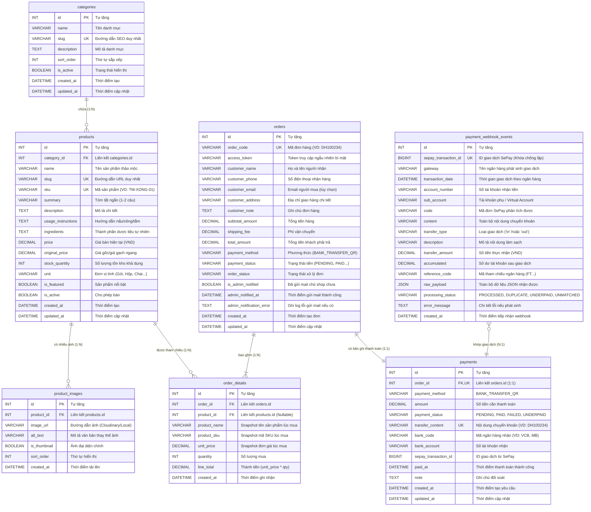

# THIẾT KẾ CƠ SỞ DỮ LIỆU (DATABASE DESIGN)
## Tên Database: `herbal_shop` (MySQL 8.x - InnoDB - utf8mb4)

---

### 1. Phân tích thiết kế và phạm vi dữ liệu

#### 1.1. Các quyết định thiết kế cốt lõi:
1. **Không tạo bảng `customers` (Khách hàng):**
   - Website hướng tới trải nghiệm mua hàng tức thì (Guest Checkout), loại bỏ rào cản tạo tài khoản, đăng nhập hoặc quên mật khẩu.
   - Toàn bộ thông tin người mua (Họ tên, Số điện thoại, Địa chỉ giao hàng, Email nhận thông báo) được lưu trữ trực tiếp trên từng bản ghi của bảng `orders`.
2. **Không tạo bảng `admin_users` (Quản trị viên):**
   - Trong giai đoạn đầu, website không có trang quản trị UI. Chủ cửa hàng tiếp nhận thông tin đơn hàng đã thanh toán qua email. Dữ liệu sản phẩm được cập nhật qua database migrations / seed script.
3. **Cơ chế Snapshot sản phẩm trong `order_details`:**
   - Bảng `order_details` lưu trữ bản sao độc lập của `product_name`, `product_sku` và `unit_price` tại chính xác thời điểm khách bấm đặt hàng.
   - Bất kỳ sự thay đổi nào về giá niêm yết, tên gọi hoặc việc xóa/ẩn sản phẩm ở bảng `products` sau này cũng hoàn toàn không làm sai lệch số liệu doanh thu và chi tiết của các đơn hàng trong quá khứ.
4. **Tách biệt Trạng thái Thanh toán (`payment_status`) và Trạng thái Đơn hàng (`order_status`):**
   - `payment_status`: Phản ánh luồng tiền ngân hàng (`PENDING` -> `PAID` / `FAILED` / `REFUNDED`).
   - `order_status`: Phản ánh luồng đóng gói giao hàng vật lý (`PENDING_PAYMENT` -> `PROCESSING` -> `SHIPPED` -> `COMPLETED` / `CANCELLED`).
5. **Cơ chế Token bảo mật đơn hàng (`access_token`):**
   - Thay vì chỉ sử dụng `order_code` (dễ bị đoán thứ tự như DH10001, DH10002), bảng `orders` bổ sung `access_token` (chuỗi ngẫu nhiên 32-64 ký tự hex). Mọi API kiểm tra trạng thái thanh toán hoặc xem đơn hàng thành công từ trình duyệt bắt buộc phải kèm theo token này.
6. **Bảng nhật ký Webhook `payment_webhook_events` (Chốt chặn Idempotency):**
   - Lưu trữ toàn bộ payload thô và trạng thái xử lý từng thông báo từ SePay. Khóa duy nhất `UNIQUE(sepay_transaction_id)` đảm bảo tuyệt đối không có 2 tiến trình nào xử lý trùng 1 giao dịch ngân hàng.

---

### 2. Sơ đồ thực thể liên kết (Entity-Relationship Diagram - ERD)



---

### 3. Từ điển dữ liệu chi tiết (Data Dictionary)

#### 3.1. Bảng `categories` (Danh mục sản phẩm thảo mộc)
| Tên cột | Kiểu dữ liệu | Ràng buộc | Mặc định | Ý nghĩa |
| :--- | :--- | :--- | :--- | :--- |
| `id` | INT UNSIGNED | PRIMARY KEY, AUTO_INCREMENT | | Định danh duy nhất |
| `name` | VARCHAR(150) | NOT NULL | | Tên danh mục (VD: Thảo mộc xông tắm, Muối ngâm chân) |
| `slug` | VARCHAR(160) | NOT NULL, UNIQUE | | Đường dẫn URL SEO |
| `description` | TEXT | NULL | | Mô tả công dụng tổng quát của danh mục |
| `sort_order` | INT | NOT NULL | 0 | Thứ tự ưu tiên hiển thị trên menu |
| `is_active` | BOOLEAN | NOT NULL | TRUE | Bật/tắt hiển thị danh mục |
| `created_at` | DATETIME | NOT NULL | CURRENT_TIMESTAMP | Ngày tạo |
| `updated_at` | DATETIME | NOT NULL | CURRENT_TIMESTAMP ON UPDATE | Ngày cập nhật |

#### 3.2. Bảng `products` (Sản phẩm thảo mộc thiên nhiên)
| Tên cột | Kiểu dữ liệu | Ràng buộc | Mặc định | Ý nghĩa |
| :--- | :--- | :--- | :--- | :--- |
| `id` | INT UNSIGNED | PRIMARY KEY, AUTO_INCREMENT | | Định danh duy nhất |
| `category_id` | INT UNSIGNED | NOT NULL, FOREIGN KEY | | Thuộc danh mục nào |
| `name` | VARCHAR(255) | NOT NULL | | Tên sản phẩm |
| `slug` | VARCHAR(255) | NOT NULL, UNIQUE | | Slug URL SEO |
| `sku` | VARCHAR(60) | NOT NULL, UNIQUE | | Mã phân loại kho |
| `summary` | VARCHAR(500) | NULL | | Giới thiệu ngắn 1-2 câu |
| `description` | TEXT | NOT NULL | | Mô tả tường tận nguồn gốc, quy trình sấy lạnh/thủ công |
| `usage_instructions`| TEXT | NULL | | Hướng dẫn đun nước xông, ngâm chân, pha trà tắm |
| `ingredients` | TEXT | NULL | | Thành phần thảo dược (Lá trầu không, gừng gió, bưởi...) |
| `price` | DECIMAL(12,2) | NOT NULL | | Giá bán lẻ hiện hành (VND) |
| `original_price` | DECIMAL(12,2) | NULL | | Giá niêm yết cũ (nếu có giảm giá) |
| `stock_quantity` | INT | NOT NULL | 0 | Số lượng tồn kho có sẵn để bán |
| `unit` | VARCHAR(50) | NOT NULL | 'Gói' | Đơn vị bán (Gói 5 túi lọc, Hũ 500g, Chai 300ml...) |
| `is_featured` | BOOLEAN | NOT NULL | FALSE | Đưa vào danh sách sản phẩm tiêu biểu trang chủ |
| `is_active` | BOOLEAN | NOT NULL | TRUE | Đang kinh doanh / Tạm ngưng |
| `created_at` | DATETIME | NOT NULL | CURRENT_TIMESTAMP | Ngày tạo |
| `updated_at` | DATETIME | NOT NULL | CURRENT_TIMESTAMP ON UPDATE | Ngày cập nhật |

#### 3.3. Bảng `product_images` (Hình ảnh sản phẩm)
| Tên cột | Kiểu dữ liệu | Ràng buộc | Mặc định | Ý nghĩa |
| :--- | :--- | :--- | :--- | :--- |
| `id` | INT UNSIGNED | PRIMARY KEY, AUTO_INCREMENT | | Khóa chính |
| `product_id` | INT UNSIGNED | NOT NULL, FOREIGN KEY (CASCADE) | | Thuộc sản phẩm nào |
| `image_url` | VARCHAR(500) | NOT NULL | | Đường dẫn URL hình ảnh |
| `alt_text` | VARCHAR(255) | NULL | | Mô tả ảnh cho SEO & Trợ năng |
| `is_thumbnail` | BOOLEAN | NOT NULL | FALSE | Ảnh đại diện chính |
| `sort_order` | INT | NOT NULL | 0 | Thứ tự hiển thị trong bộ sưu tập ảnh |
| `created_at` | DATETIME | NOT NULL | CURRENT_TIMESTAMP | Ngày tải lên |

#### 3.4. Bảng `orders` (Đơn đặt hàng & Người nhận)
| Tên cột | Kiểu dữ liệu | Ràng buộc | Mặc định | Ý nghĩa |
| :--- | :--- | :--- | :--- | :--- |
| `id` | INT UNSIGNED | PRIMARY KEY, AUTO_INCREMENT | | Khóa chính |
| `order_code` | VARCHAR(30) | NOT NULL, UNIQUE | | Mã đơn hiển thị (VD: DH100234) |
| `access_token` | VARCHAR(64) | NOT NULL | | Mã bảo mật xem đơn hàng (Chống đoán ID) |
| `customer_name` | VARCHAR(150) | NOT NULL | | Họ tên người nhận hàng |
| `customer_phone`| VARCHAR(20) | NOT NULL | | SĐT liên hệ nhận hàng |
| `customer_email`| VARCHAR(150) | NULL | | Email khách nhận xác nhận (tùy chọn) |
| `customer_address`| VARCHAR(500) | NOT NULL | | Địa chỉ nhận hàng chi tiết |
| `customer_note` | TEXT | NULL | | Ghi chú đơn hàng của khách |
| `subtotal_amount`| DECIMAL(12,2) | NOT NULL | | Tổng giá trị hàng hóa |
| `shipping_fee` | DECIMAL(12,2) | NOT NULL | 0.00 | Phí vận chuyển |
| `total_amount` | DECIMAL(12,2) | NOT NULL | | Tổng thanh toán cuối cùng |
| `payment_method`| VARCHAR(50) | NOT NULL | 'BANK_TRANSFER_QR' | Hình thức thanh toán |
| `payment_status`| VARCHAR(30) | NOT NULL | 'PENDING' | PENDING, PAID, FAILED, UNDERPAID, CANCELLED |
| `order_status` | VARCHAR(30) | NOT NULL | 'PENDING_PAYMENT'| PENDING_PAYMENT, PROCESSING, SHIPPED, COMPLETED, CANCELLED |
| `is_admin_notified`| BOOLEAN | NOT NULL | FALSE | Đã gửi mail thông báo cho chủ shop chưa |
| `admin_notified_at`| DATETIME | NULL | | Thời điểm gửi mail thành công |
| `admin_notification_error` | TEXT | NULL | | Nhật ký lỗi nếu gửi mail thất bại |
| `created_at` | DATETIME | NOT NULL | CURRENT_TIMESTAMP | Ngày tạo đơn |
| `updated_at` | DATETIME | NOT NULL | CURRENT_TIMESTAMP ON UPDATE | Ngày cập nhật |

#### 3.5. Bảng `order_details` (Chi tiết từng món trong đơn)
| Tên cột | Kiểu dữ liệu | Ràng buộc | Mặc định | Ý nghĩa |
| :--- | :--- | :--- | :--- | :--- |
| `id` | INT UNSIGNED | PRIMARY KEY, AUTO_INCREMENT | | Khóa chính |
| `order_id` | INT UNSIGNED | NOT NULL, FOREIGN KEY (CASCADE) | | Thuộc đơn hàng nào |
| `product_id` | INT UNSIGNED | NULL, FOREIGN KEY (SET NULL) | | Tham chiếu sản phẩm gốc |
| `product_name` | VARCHAR(255) | NOT NULL | | Tên sản phẩm tại thời điểm mua |
| `product_sku` | VARCHAR(60) | NOT NULL | | Mã SKU tại thời điểm mua |
| `unit_price` | DECIMAL(12,2) | NOT NULL | | Đơn giá tại thời điểm mua |
| `quantity` | INT | NOT NULL | | Số lượng đặt mua |
| `line_total` | DECIMAL(12,2) | NOT NULL | | Thành tiền của dòng (`unit_price * qty`) |
| `created_at` | DATETIME | NOT NULL | CURRENT_TIMESTAMP | Thời điểm tạo |

#### 3.6. Bảng `payments` (Thông tin thanh toán ngân hàng)
| Tên cột | Kiểu dữ liệu | Ràng buộc | Mặc định | Ý nghĩa |
| :--- | :--- | :--- | :--- | :--- |
| `id` | INT UNSIGNED | PRIMARY KEY, AUTO_INCREMENT | | Khóa chính |
| `order_id` | INT UNSIGNED | NOT NULL, UNIQUE, FOREIGN KEY | | Đơn hàng cần thanh toán |
| `payment_method`| VARCHAR(50) | NOT NULL | 'BANK_TRANSFER_QR' | Hình thức chuyển khoản VietQR |
| `amount` | DECIMAL(12,2) | NOT NULL | | Số tiền chính xác cần chuyển |
| `payment_status`| VARCHAR(30) | NOT NULL | 'PENDING' | PENDING, PAID, FAILED, UNDERPAID |
| `transfer_content`| VARCHAR(50) | NOT NULL, UNIQUE | | Nội dung bắt buộc chuyển (VD: DH100234) |
| `bank_code` | VARCHAR(30) | NOT NULL | | Mã ngân hàng nhận (VD: Vietcombank, MB) |
| `bank_account` | VARCHAR(50) | NOT NULL | | Số tài khoản nhận tiền |
| `sepay_transaction_id`| BIGINT | NULL | | ID giao dịch từ SePay sau khi khớp |
| `paid_at` | DATETIME | NULL | | Thời điểm nhận được tiền |
| `note` | TEXT | NULL | | Ghi chú đối soát hoặc lý do lỗi |
| `created_at` | DATETIME | NOT NULL | CURRENT_TIMESTAMP | Thời điểm tạo lệnh |
| `updated_at` | DATETIME | NOT NULL | CURRENT_TIMESTAMP ON UPDATE | Thời điểm cập nhật |

#### 3.7. Bảng `payment_webhook_events` (Nhật ký giao dịch SePay)
| Tên cột | Kiểu dữ liệu | Ràng buộc | Mặc định | Ý nghĩa |
| :--- | :--- | :--- | :--- | :--- |
| `id` | INT UNSIGNED | PRIMARY KEY, AUTO_INCREMENT | | Khóa chính |
| `sepay_transaction_id`| BIGINT | NOT NULL, UNIQUE | | ID giao dịch SePay (Khóa chống trùng lặp) |
| `gateway` | VARCHAR(50) | NOT NULL | | Tên ngân hàng nhận (Vietcombank, ACB...) |
| `transaction_date`| DATETIME | NOT NULL | | Thời gian ghi nhận tại ngân hàng |
| `account_number`| VARCHAR(50) | NOT NULL | | Số tài khoản nhận tiền |
| `sub_account` | VARCHAR(50) | NULL | | Tài khoản phụ (nếu dùng Virtual Account) |
| `code` | VARCHAR(50) | NULL | | Mã thanh toán do SePay trích xuất |
| `content` | VARCHAR(500) | NOT NULL | | Toàn văn nội dung chuyển khoản |
| `transfer_type`| VARCHAR(10) | NOT NULL | | 'in' (tiền vào) hoặc 'out' (tiền ra) |
| `description` | VARCHAR(500) | NULL | | Mô tả đã chuẩn hóa |
| `transfer_amount`| DECIMAL(12,2)| NOT NULL | | Số tiền chuyển thực tế |
| `accumulated` | DECIMAL(15,2)| NULL | | Số dư sau giao dịch |
| `reference_code`| VARCHAR(100)| NULL | | Mã tham chiếu ngân hàng (FT...) |
| `raw_payload` | JSON | NOT NULL | | Toàn bộ payload SePay gửi đến |
| `processing_status`| VARCHAR(30)| NOT NULL | 'PROCESSED' | PROCESSED, DUPLICATE, UNDERPAID, UNMATCHED |
| `error_message` | TEXT | NULL | | Chi tiết nếu đối soát gặp lỗi |
| `created_at` | DATETIME | NOT NULL | CURRENT_TIMESTAMP | Thời gian ghi nhận |

---

### 4. Đề xuất Index tối ưu hiệu năng truy vấn

```sql
-- 1. Index cho bảng products
CREATE INDEX idx_products_category ON products(category_id);
CREATE INDEX idx_products_active_created ON products(is_active, created_at DESC);
CREATE INDEX idx_products_price ON products(price);

-- 2. Index cho bảng orders
CREATE INDEX idx_orders_code ON orders(order_code);
CREATE INDEX idx_orders_access_token ON orders(access_token);
CREATE INDEX idx_orders_payment_status ON orders(payment_status);
CREATE INDEX idx_orders_customer_phone ON orders(customer_phone);

-- 3. Index cho bảng order_details
CREATE INDEX idx_order_details_order_id ON order_details(order_id);

-- 4. Index cho bảng payments
CREATE INDEX idx_payments_order_id ON payments(order_id);
CREATE INDEX idx_payments_transfer_content ON payments(transfer_content);
CREATE INDEX idx_payments_status ON payments(payment_status);

-- 5. Index cho bảng payment_webhook_events
CREATE INDEX idx_webhook_code ON payment_webhook_events(code);
CREATE INDEX idx_webhook_account ON payment_webhook_events(account_number);
CREATE INDEX idx_webhook_created ON payment_webhook_events(created_at DESC);
```

