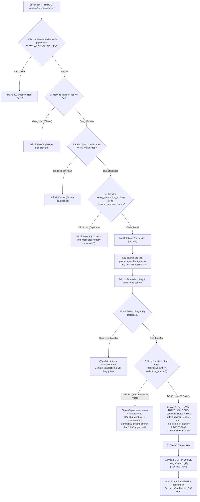

# QUY TRÌNH THANH TOÁN VÀ XÁC NHẬN GIAO DỊCH (PAYMENT FLOW)
## Tích Hợp Cổng Thanh Toán SePay VietQR & Thông Báo Đơn Hàng

---

### 1. Cơ chế sinh mã VietQR động

Khi khách hàng bấm nút **"Xác nhận đặt hàng"**, Backend sẽ khởi tạo đơn hàng và trả về đường dẫn sinh mã QR chuẩn VietQR (chuẩn NAPAS liên ngân hàng Việt Nam).

#### 1.1. Cấu trúc URL VietQR động
Hệ thống sử dụng cú pháp chuẩn từ dịch vụ VietQR / SePay:
```http
https://vietqr.app/img?acc={ACCOUNT_NUMBER}&bank={BANK_NAME}&amount={AMOUNT}&des={DESCRIPTION}&template={TEMPLATE}
```

Trong đó:
- `acc`: Số tài khoản ngân hàng của chủ shop (Lấy từ biến môi trường `SEPAY_ACCOUNT_NUMBER`).
- `bank`: Tên rút gọn của ngân hàng hoặc BIN code (Ví dụ: `Vietcombank`, `VCB` hoặc `MB`).
- `amount`: Số tiền chính xác của đơn hàng (sau khi Backend đã cộng phí vận chuyển). Không để trống để tránh khách hàng nhập sai số tiền.
- `des`: Nội dung chuyển khoản duy nhất, quy ước tiền tố cố định kèm mã đơn hàng. Ví dụ: `DH100234`.
- `template`: Kiểu bố cục hiển thị mã QR (Giá trị: `compact` để hiển thị logo VietQR, ngân hàng và thông tin tóm tắt trang nhã).

#### 1.2. Trải nghiệm người dùng tại màn hình Thanh toán
- Khách hàng mở ứng dụng Mobile Banking của bất kỳ ngân hàng nào tại Việt Nam (Vietcombank, Techcombank, MB, VPBank, ACB, BIDV...).
- Chọn tính năng **Quét mã QR**.
- Ứng dụng ngân hàng sẽ tự động điền:
  1. Tên chủ tài khoản: `TIEM THAO MOC NGAN HA`
  2. Số tài khoản nhận.
  3. Số tiền cần chuyển (không cho phép sửa).
  4. Nội dung chuyển khoản: `DH100234` (khuyên người dùng không xóa/sửa nội dung này).
- Khách hàng bấm xác nhận chuyển tiền trên app ngân hàng.

---

### 2. Quy trình 9 bước tiếp nhận và xử lý Webhook SePay



---

### 3. Xử lý các tình huống biên và sự cố (Edge Cases)

#### 3.1. Chống xử lý trùng lặp giao dịch (Idempotency)
- **Tình huống:** SePay có cơ chế thử lại (Retry) nếu phía server nhận Webhook phản hồi chậm hơn 30 giây hoặc mạng bị ngắt quãng. Do đó, 1 giao dịch có thể gửi tới 2-3 lần.
- **Giải pháp:**
  - Cột `sepay_transaction_id` trong bảng `payment_webhook_events` có ràng buộc `UNIQUE`.
  - Khi SePay gửi lại, câu lệnh insert sẽ ném lỗi trùng khóa (Duplicate Key).
  - Backend lập tức bắt lỗi này, không thực hiện lại logic cập nhật đơn hay gửi mail, mà trả về ngay HTTP `200 OK` kèm `{ "success": true, "message": "Transaction already processed" }`.

#### 3.2. Khách hàng chuyển thiếu tiền (`UNDERPAID`)
- **Tình huống:** Đơn hàng 490.000đ nhưng khách chuyển nhầm 49.000đ hoặc 400.000đ.
- **Giải pháp:**
  - Hệ thống **tuyệt đối không** cập nhật đơn hàng thành `PAID` và **không** gửi email đơn mới cho chủ shop.
  - Cập nhật bản ghi thanh toán `payments.payment_status = 'UNDERPAID'` và lưu số tiền thực nhận.
  - Ghi log cảnh báo để chủ shop có thể tra soát ngân hàng thủ công.

#### 3.3. Khách hàng chuyển thừa tiền
- **Tình huống:** Đơn hàng 490.000đ nhưng khách chuyển tròn 500.000đ (hoặc bo thêm tiền tip).
- **Giải pháp:**
  - Điều kiện chấp nhận là `transferAmount >= order.total_amount`.
  - Hệ thống vẫn cập nhật đơn hàng sang `PAID`, trừ kho và gửi email thông báo cho chủ shop.
  - Trong nội dung email gửi chủ shop, ghi rõ: *"Khách đã chuyển: 500.000đ (Thừa 10.000đ so với giá trị đơn 490.000đ)"* để chủ shop chủ động liên hệ hoặc hoàn tiền cho khách.

#### 3.4. Khách hàng ghi sai hoặc quên nội dung chuyển khoản (`UNMATCHED`)
- **Tình huống:** Khách hàng xóa mã `DH100234` và ghi *"Nguyen Van A mua thao moc"*.
- **Giải pháp:**
  - Backend sử dụng biểu thức chính quy (Regex) quét toàn bộ chuỗi `content` để tìm cụm ký tự khớp định dạng `DH[0-9]{6}`.
  - Nếu vẫn không tìm thấy mã đơn: Bản ghi webhook được lưu vào `payment_webhook_events` với trạng thái `UNMATCHED`.
  - Trả về `200 OK` cho SePay để kết thúc webhook, lưu log để chủ shop đối soát số tiền nhận được trên tài khoản ngân hàng.

---

### 4. Quy trình gửi Email thông báo đơn hàng cho Chủ Shop

#### 4.1. Kiến trúc phân tách an toàn của Email Service
- Email Service được chạy **hoàn toàn độc lập** sau khi Database Transaction đã commit thành công.
- Việc gửi email thông qua mạng Internet (SMTP) có thể bị chậm (1-3 giây). Việc chạy bất đồng bộ giúp API Webhook của SePay được phản hồi ngay lập tức (dưới 500ms), tránh việc SePay bị timeout và retry không cần thiết.

#### 4.2. Mẫu nội dung Email gửi Chủ Cửa Hàng
- **Người nhận:** Email chủ cửa hàng (Cấu hình qua biến môi trường `STORE_OWNER_EMAIL`).
- **Tiêu đề email:**
  `[TIỆM THẢO MỘC NGÂN HÀ] Đơn hàng mới đã thanh toán - #DH100234`
- **Nội dung HTML:**
  ```html
  <div style="font-family: Arial, sans-serif; max-width: 600px; margin: 0 auto; border: 1px solid #e2e8f0; border-radius: 8px; overflow: hidden;">
    <div style="background-color: #1a382b; color: #ffffff; padding: 20px; text-align: center;">
      <h2 style="margin: 0;">THÔNG BÁO ĐƠN HÀNG MỚI ĐÃ THANH TOÁN</h2>
      <p style="margin: 5px 0 0 0; font-size: 14px;">Mã đơn hàng: <strong>#DH100234</strong></p>
    </div>

    <div style="padding: 24px;">
      <p>Chào bạn, hệ thống vừa ghi nhận một đơn hàng thảo mộc mới đã được thanh toán chuyển khoản thành công qua SePay:</p>
      
      <h3 style="color: #1a382b; border-bottom: 2px solid #e2e8f0; padding-bottom: 6px;">1. THÔNG TIN KHÁCH HÀNG & GIAO HÀNG</h3>
      <table style="width: 100%; font-size: 14px; line-height: 1.6;">
        <tr><td style="width: 140px; color: #64748b;">Họ tên khách:</td><td><strong>Nguyễn Thị Hoa</strong></td></tr>
        <tr><td style="color: #64748b;">Số điện thoại:</td><td><strong><a href="tel:0987654321">0987654321</a></strong></td></tr>
        <tr><td style="color: #64748b;">Địa chỉ giao hàng:</td><td>Số 45 Ngõ 12 Đường Cây Trâm, P.8, Gò Vấp, TP.HCM</td></tr>
        <tr><td style="color: #64748b;">Ghi chú của khách:</td><td><em>Giao hàng giờ hành chính giúp mình</em></td></tr>
      </table>

      <h3 style="color: #1a382b; border-bottom: 2px solid #e2e8f0; padding-bottom: 6px; margin-top: 24px;">2. CHI TIẾT SẢN PHẨM</h3>
      <table style="width: 100%; border-collapse: collapse; font-size: 14px;">
        <thead>
          <tr style="background-color: #f8fafc; text-align: left;">
            <th style="padding: 8px; border: 1px solid #e2e8f0;">Sản phẩm</th>
            <th style="padding: 8px; border: 1px solid #e2e8f0; text-align: center;">SL</th>
            <th style="padding: 8px; border: 1px solid #e2e8f0; text-align: right;">Đơn giá</th>
            <th style="padding: 8px; border: 1px solid #e2e8f0; text-align: right;">Thành tiền</th>
          </tr>
        </thead>
        <tbody>
          <tr>
            <td style="padding: 8px; border: 1px solid #e2e8f0;">Túi Thảo Mộc Tắm Sau Sinh Cổ Truyền (10 túi lọc)</td>
            <td style="padding: 8px; border: 1px solid #e2e8f0; text-align: center;">2</td>
            <td style="padding: 8px; border: 1px solid #e2e8f0; text-align: right;">185.000 ₫</td>
            <td style="padding: 8px; border: 1px solid #e2e8f0; text-align: right;">370.000 ₫</td>
          </tr>
          <tr>
            <td style="padding: 8px; border: 1px solid #e2e8f0;">Muối Khoáng Ngâm Chân Thảo Mộc Hoa Hồi & Quế Chi (500g)</td>
            <td style="padding: 8px; border: 1px solid #e2e8f0; text-align: center;">1</td>
            <td style="padding: 8px; border: 1px solid #e2e8f0; text-align: right;">120.000 ₫</td>
            <td style="padding: 8px; border: 1px solid #e2e8f0; text-align: right;">120.000 ₫</td>
          </tr>
        </tbody>
        <tfoot>
          <tr>
            <td colspan="3" style="padding: 8px; text-align: right; border: 1px solid #e2e8f0;">Tổng tiền hàng:</td>
            <td style="padding: 8px; text-align: right; border: 1px solid #e2e8f0;">490.000 ₫</td>
          </tr>
          <tr>
            <td colspan="3" style="padding: 8px; text-align: right; border: 1px solid #e2e8f0;">Phí vận chuyển:</td>
            <td style="padding: 8px; text-align: right; border: 1px solid #e2e8f0;">0 ₫ (Miễn phí)</td>
          </tr>
          <tr style="font-weight: bold; color: #1a382b; font-size: 16px;">
            <td colspan="3" style="padding: 8px; text-align: right; border: 1px solid #e2e8f0;">TỔNG THANH TOÁN:</td>
            <td style="padding: 8px; text-align: right; border: 1px solid #e2e8f0; color: #b91c1c;">490.000 ₫</td>
          </tr>
        </tfoot>
      </table>

      <h3 style="color: #1a382b; border-bottom: 2px solid #e2e8f0; padding-bottom: 6px; margin-top: 24px;">3. THÔNG TIN ĐỐI SOÁT NGÂN HÀNG (SEPAY)</h3>
      <table style="width: 100%; font-size: 14px; line-height: 1.6;">
        <tr><td style="width: 140px; color: #64748b;">Ngân hàng nhận:</td><td>Vietcombank</td></tr>
        <tr><td style="color: #64748b;">Số tiền thực nhận:</td><td><strong style="color: #166534;">490.000 ₫</strong></td></tr>
        <tr><td style="color: #64748b;">Mã giao dịch (FT):</td><td>FT261102987123</td></tr>
        <tr><td style="color: #64748b;">Thời gian GD:</td><td>02/11/2026 23:45:10</td></tr>
      </table>

      <p style="margin-top: 24px; font-size: 13px; color: #64748b; text-align: center;">
        Vui lòng kiểm tra đóng gói sản phẩm và liên hệ đơn vị giao hàng gửi cho khách sớm nhất.
      </p>
    </div>
  </div>
  ```

#### 4.3. Đảm bảo tính tin cậy của quy trình Email:
1. **Chỉ gửi 1 lần duy nhất:** Trước khi gọi `Nodemailer`, Backend kiểm tra trường `is_admin_notified === FALSE`. Khi gửi xong, lập tức cập nhật:
   ```sql
   UPDATE orders SET is_admin_notified = TRUE, admin_notified_at = NOW() WHERE id = ?;
   ```
2. **Khả năng chịu lỗi (Fault-Tolerance):** Nếu SMTP của nhà mạng gặp sự cố (sai mật khẩu ứng dụng, timeout mạng), lỗi được bắt trong `try/catch`, ghi chi tiết lỗi vào `admin_notification_error` trong database. Đơn hàng **vẫn giữ nguyên trạng thái `PAID`** và không bao giờ bị rollback tiền của khách.

