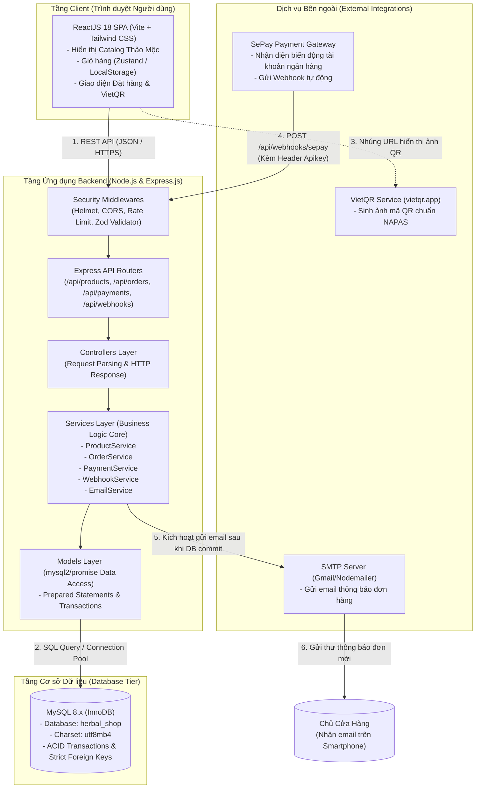
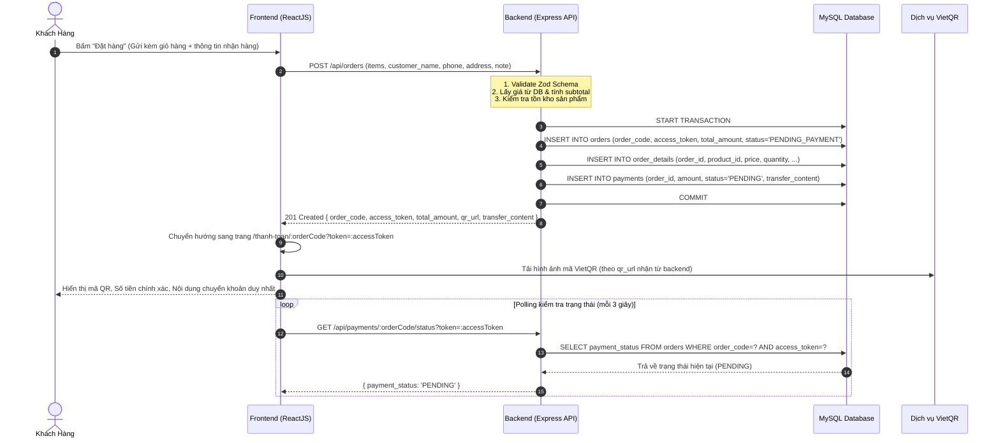
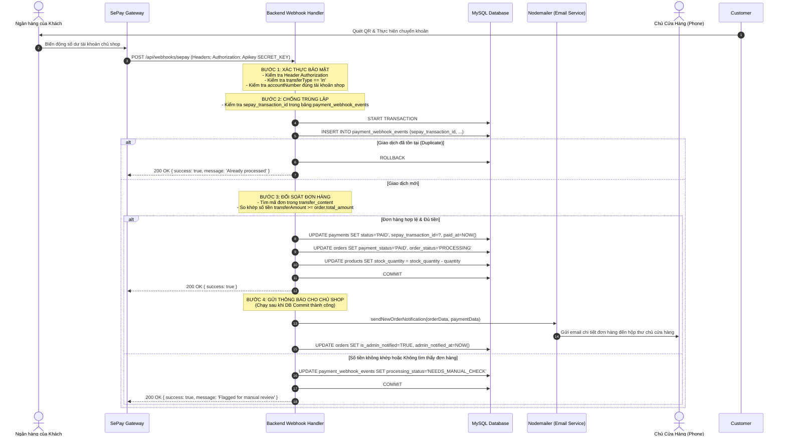

# THIẾT KẾ KIẾN TRÚC HỆ THỐNG (SYSTEM ARCHITECTURE)
## Website Thương Mại Điện Tử Sản Phẩm Thảo Mộc Thiên Nhiên

---

### 1. Kiến trúc tổng thể (High-Level Architecture)

Hệ thống được thiết kế theo kiến trúc Client - Server tách rời (Decoupled Client-Server Architecture) với mô hình phân lớp chuẩn (Layered Architecture).

---

### 2. Trách nhiệm của các thành phần trong hệ thống

#### 2.1. Tầng Client (Frontend - ReactJS)
- **Nhiệm vụ:**
  - Cung cấp trải nghiệm mua sắm mượt mà, thân thiện với người dùng tìm kiếm sản phẩm thảo dược và chăm sóc tự nhiên.
  - Quản lý trạng thái giỏ hàng độc lập tại client thông qua `localStorage` (khách hàng không cần đăng nhập).
  - Thu thập thông tin giao hàng (Họ tên, SĐT, Địa chỉ) và gửi yêu cầu tạo đơn hàng lên Backend.
  - Hiển thị mã thanh toán VietQR động cho khách hàng quét mã trên ứng dụng ngân hàng.
  - Thực hiện kiểm tra định kỳ (Polling với khoảng thời gian hợp lý, ví dụ mỗi 3-5 giây) trạng thái đơn hàng bằng API an toàn.
- **Ràng buộc an toàn:**
  - ⚠️ **Frontend tuyệt đối không có quyền tự quyết định trạng thái thanh toán.**
  - Không gửi số tiền cần thanh toán lên backend để xác nhận; toàn bộ giá sản phẩm và tổng tiền bắt buộc phải do Backend thẩm định và tính toán lại từ cơ sở dữ liệu.

#### 2.2. Tầng Ứng dụng (Backend - Express.js)
- **Nhiệm vụ:**
  - Đóng vai trò là **Nguồn sự thật duy nhất (Single Source of Truth)** cho toàn bộ nghiệp vụ.
  - Kiểm tra và xác thực dữ liệu đầu vào (Zod Schema Validation).
  - Khởi tạo mã đơn hàng duy nhất (`order_code`) và mã token truy cập ngẫu nhiên bí mật (`access_token`) để chống việc đoán mã đơn hàng.
  - Sinh URL ảnh VietQR động với nội dung chuyển khoản đặc thù.
  - Tiếp nhận và xác thực Webhook từ SePay.
  - Quản lý Database Transaction khi đối soát và cập nhật thanh toán.
  - Kích hoạt dịch vụ gửi email thông báo sau khi đơn hàng chuyển sang trạng thái đã thanh toán (`PAID`).
- **Ràng buộc an toàn:**
  - Tất cả các thao tác cập nhật tiền tệ và tồn kho bắt buộc phải nằm trong Database Transaction (`START TRANSACTION ... COMMIT / ROLLBACK`).
  - Webhook chỉ được chấp nhận nếu vượt qua bước kiểm tra API Key (`Authorization: Apikey ...`).

#### 2.3. Tầng Dữ liệu (Database - MySQL 8.x)
- Sử dụng Storage Engine **InnoDB** với hỗ trợ Transaction ACID toàn vẹn.
- Bảng `payment_webhook_events` đóng vai trò chốt chặn chống trùng lặp giao dịch (Idempotency Lock) nhờ chỉ mục `UNIQUE(sepay_transaction_id)`.
- Lưu trữ lịch sử giao dịch thanh toán và đơn hàng rõ ràng, tách biệt giữa trạng thái thanh toán (`payment_status`) và trạng thái xử lý đơn hàng (`order_status`).

#### 2.4. Các Dịch vụ Bên ngoài (External Services)
- **SePay:** Lắng nghe biến động số dư tài khoản ngân hàng của chủ shop qua SMS/App ngân hàng và gửi Webhook theo thời gian thực (Real-time).
- **VietQR:** Cung cấp định dạng ảnh QR chuyển khoản tức thì theo chuẩn ngân hàng Việt Nam.
- **Nodemailer / SMTP:** Chịu trách nhiệm chuyển phát email thông báo đơn hàng kèm đầy đủ chi tiết sản phẩm tới chủ shop.

---

### 3. Sơ đồ tuần tự các luồng xử lý chính (Sequence Diagrams)

#### 3.1. Luồng Đặt hàng và Hiển thị QR Thanh toán

---

#### 3.2. Luồng Tiếp nhận Webhook SePay, Xác thực & Gửi Email Chủ Cửa Hàng

---

### 4. 4 Nguyên tắc bảo mật cốt lõi của hệ thống

1. **Frontend không bao giờ được tự xác nhận thanh toán:**
   - Trạng thái `PAID` chỉ được kích hoạt bởi Webhook từ SePay sau khi đi qua chuỗi kiểm tra đa lớp ở Backend.
   - Frontend chỉ gửi request truy vấn trạng thái (Read-only polling) kèm theo `access_token` để biết khi nào cần điều hướng khách hàng sang màn hình thành công.
2. **Backend là nơi duy nhất xử lý và xác nhận giao dịch (Single Source of Truth):**
   - Giá trị đơn hàng, phí vận chuyển, tồn kho được tính toán và khóa lại ngay tại thời điểm tạo đơn trong bảng `orders` và `order_details`.
3. **Webhook bắt buộc phải xác thực nguồn gửi:**
   - Mọi request gửi đến `/api/webhooks/sepay` không có header `Authorization: Apikey <SEPAY_WEBHOOK_API_KEY>` hoặc sai khóa sẽ bị từ chối ngay lập tức bằng mã lỗi `401 Unauthorized`.
4. **Email thông báo chỉ được kích hoạt sau khi dữ liệu được Commit thành công:**
   - Nếu việc ghi dữ liệu vào MySQL gặp sự cố và bị `ROLLBACK`, email tuyệt đối không được phát đi, tránh trường hợp chủ shop nhận được thông báo ảo khi tiền chưa vào tài khoản hoặc dữ liệu đơn bị lỗi.

